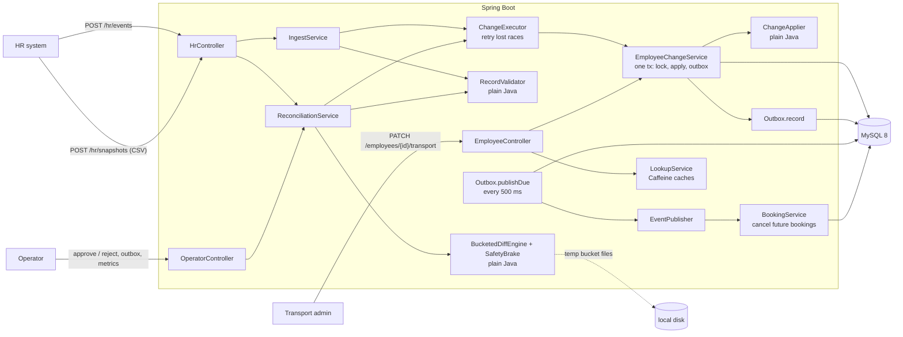
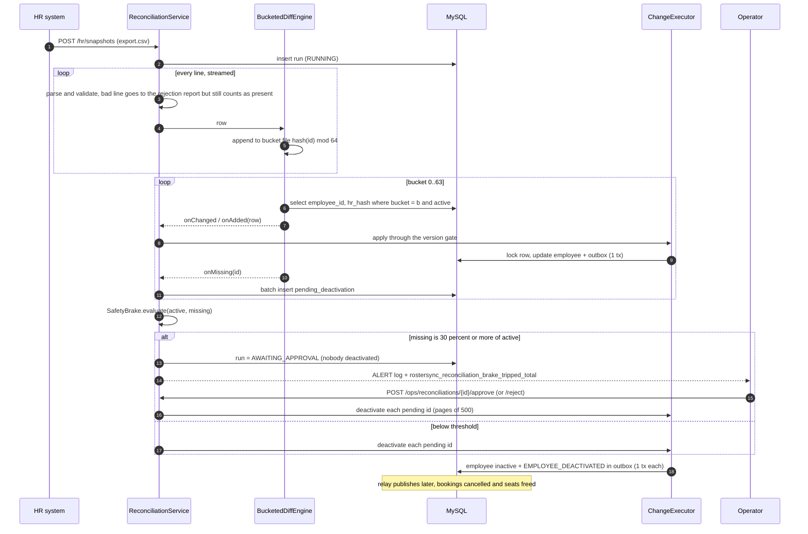

# Design Note: HR Roster Sync

## 1. The problem

HR systems push employee changes (create / update / deactivate) in near real time, plus a full export of up to
200,000 employees every night. Messages arrive twice, out of order, with bad data, and exports get cut short.
We must keep one correct record per (tenant, employee), never let HR overwrite transport-admin fields, emit one
change event per applied change, and never mass-deactivate people because a file was broken.

## 2. Architecture

The `core` package (version gate, ownership, validation, diff, brake) is plain Java with no Spring or database
imports, so its tests run in milliseconds. Spring wraps it in controller → service → repository layers.

## 3. Key decisions

| Topic | Decision |
|---|---|
| Idempotency key | `(tenantId, employeeId, version)`. The stored `hr_version` is the high-water mark. |
| Version comparison | no row → apply; `incoming > stored` → apply; `<` → STALE (ignored); `==` with the same content hash → DUPLICATE (no-op); `==` with different content → VERSION_CONFLICT (rejected and reported). |
| Event semantics | State transfer: every create/update carries all HR-owned fields. That makes "drop stale" safe (v7 already holds the v7 shift). An update before its create is applied as the first state; a deactivate for an unknown employee leaves a tombstone so a late create cannot resurrect them. |
| Per-employee order | `SELECT ... FOR UPDATE` on the employee row, across threads and app instances. A first-insert race fails on the unique key and `ChangeExecutor` retries (max 3). |
| Field ownership | Each `Field` constant has one owner. HR: name, email, phone, manager, office, shift. Transport admin: pickup point, special assistance. **Conflict rule:** a write from a non-owner is dropped for that field only, the rest of the record applies, and the response lists the ignored field names. Admin edits never bump `hr_version`. |
| Outbox | Employee row and `outbox_event` row are written in one transaction (`Outbox.record` is `MANDATORY`). The relay publishes in id order, at-least-once; consumers dedupe on `eventId`. Payload has ids and changed field names, no personal data. |
| Nightly diff | Stream the file, hash each id into 64 buckets, spill to 64 temp files. Then per bucket: load ~3k rows into a map and stream the store's `(employee_id, hr_hash)` for that bucket using the `(tenant_id, bucket, active)` index. Memory is one bucket, not the file. |
| Safety brake | `missing / active ≥ threshold` (default 0.30, env `BRAKE_THRESHOLD`) → run `AWAITING_APPROVAL`, alert logged and counted, **nobody deactivated**. Missing ids wait in `pending_deactivation` until an operator approves or rejects. A rejected row still counts as present, so a typo never deactivates anyone. |
| Nightly vs live | File rows go through the same version gate as API events, so a stale export cannot undo a newer live event. Reconciliation deactivation keeps the HR version and skips anyone updated after the run started. |
| Authentication | Login: `DaoAuthenticationProvider` loads the user from `app_user` through `UserAccountService`, checks the BCrypt hash and the API returns an HS256-signed JWT (1 h) carrying role and tenant. Every other request: `JwtAuthenticationFilter` verifies the token, no session and no DB lookup. |
| Tenant isolation | The tenant comes only from the signed token (`tid` claim), never from the request body or path. Every query filters on it; another tenant's record is a 404, not a 403. Cache keys include the tenant. |

## 4. Hardest flow: nightly reconciliation with the safety brake

## 5. Failure modes

| What fails | What the client sees | How the system recovers |
|---|---|---|
| Same event delivered twice | `duplicates: 1`; nothing changes | Same version + same hash is a no-op; no outbox row |
| Events out of order | Older one counted as `stale` | Version gate ignores lower versions |
| Same version, different content | `VERSION_CONFLICT` for that record | Not applied; counted in `events_rejected{reason="VERSION_CONFLICT"}` |
| Bad phone / unknown office | Per-record error `{index, employeeId, field, code}`; others applied | HR fixes and resends |
| Crash after the employee write, before commit | Timeout / 5xx to HR | Rollback: no row, no event. HR retry applies once (`ResilienceIT`) |
| Crash after commit, before publish | Nothing; change is in the DB | Event waits in `outbox_event`; relay publishes after restart (`ResilienceIT`) |
| Crash after publish, before marking | Consumer may get the event twice | Same `eventId`; booking cancel is idempotent |
| Broker / consumer down | `outbox_queue_depth` and `outbox_lag_seconds` rise | Backoff 1 s → 60 s, retried in order |
| Two first creates race | One `applied`, the rest `duplicate` | Unique key violation → retry under lock |
| Lock wait / deadlock | Slightly higher latency | Retried up to 3 times, counted in `apply_retries` |
| Truncated nightly file | Run `AWAITING_APPROVAL` with `missingFromFile`; alert | Nobody deactivated until an operator approves |
| File without header | Run `FAILED` | Nothing that could deactivate anyone was done |
| App dies mid-reconciliation | Run stuck `RUNNING` | Marked `FAILED (INTERRUPTED)` at startup. During the diff nobody has been deactivated yet. During the final deactivation step some leavers may already be inactive; the rest stay active and are found missing again by the next nightly run |
| Wrong password / unknown user | 401 `INVALID_CREDENTIALS`, same for both | Client retries with correct credentials |
| Missing, expired or forged token | 401 `UNAUTHENTICATED` | Client logs in again |
| Unexpected bug | 500 `INTERNAL_ERROR` with `traceId` only | Stack trace in logs under that traceId |

## 6. Trade-offs

* **Consistency over write availability.** Every change takes a MySQL row lock. If MySQL is down, ingest fails
  and HR retries, rather than accepting writes we could not order.
* **At-least-once events, not exactly-once.** Exactly-once across DB and broker needs two-phase commit; outbox plus
  idempotent consumers gives the same visible result with far less machinery.
* **Event latency vs simplicity.** Polling every 500 ms means downstream sees a change up to ~0.5 s late. CDC
  (Debezium on the binlog) would cut that, at the cost of more infrastructure.
* **Synchronous reconciliation.** The upload request runs the whole diff (seconds for 200k unchanged rows). Simple
  to test; production would accept the file, return a run id and process it in a worker.
* **Cache staleness.** Reads may be up to 30 s stale on other instances. Writes never read the cache.

Deliberately left out: a real broker (one `EventPublisher` implementation swaps in Kafka); several relay
instances (needs `SELECT ... FOR UPDATE SKIP LOCKED` or a leader lock); delta events from HR; refresh tokens and
token revocation (a token stays valid until it expires, at most 1 h; production would add a refresh flow or an
external identity provider); CSV quoting (the export contract has no commas in values).

## 7. Cost and where it stops scaling

| Operation | Time | Space |
|---|---|---|
| Apply one event | O(1) round trips: lock by unique index, update, outbox insert | O(1) |
| Batch of k events | O(k) transactions | O(k) for the report |
| Nightly diff, F file rows, S stored, B buckets | O(F + S) hashing + one indexed scan per bucket | O(F / B) file rows in memory (store rows are streamed), O(B) buffers, O(F) temp disk |
| Applying C changes and M deactivations | O(C + M) transactions | O(1), pending ids paged from the DB |

Limits: one hot employee serialises on one row lock (by design); a single MySQL primary caps writes at a few
thousand per second (next step: shard by tenant); one relay publishes sequentially; a night where all 200k rows
changed means 200k transactions (minutes, not seconds); 64 buckets suit ~200k employees, 20M would need more
(a backfill of the `bucket` column).
